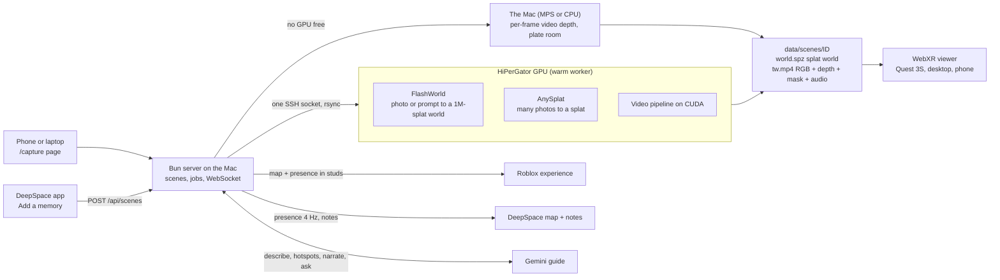

# Déjà View

**You've seen this before. Now walk around in it.**

Add a memory to the shared board, walk into it in a Meta Quest 3S or a browser, and bring your friends.

## What it does

**Photo.** One photo, a game screenshot or a single sentence becomes a world you can walk around in. A world model
generates everything the camera never saw: the corners, the ceiling, the room behind you. We built three OG Tilted
Towers worlds from one screenshot each, and in each one only 14%, 21.7% and 22.9% of the million splats were actually
in the screenshot. The model made up the rest.

**Video.** Prop up a phone and record. Whatever stays still in the shot becomes the room, and the real footage (the
people, their hands, the snacks, the yelling) stands inside it in 3D with the original sound. Every frame gets its own
depth.

**The social layer.**

- **Roblox.** The same room becomes a life-size Roblox map (3.57 studs per metre). Friends without a headset join from
  a laptop and play tag with whoever is in VR. In the headset they appear as ghosts.
- **Notes.** Click a spot on the room map in the DeepSpace app and type a note. It pops up in the headset as a sticky
  note and stays there for the next visitor. You can pin one from inside the headset too.
- **Voice guide.** Gemini pins floating labels on the things worth asking about. Hold a button, ask "who won?", and the
  room answers out loud.
- **Reality check.** One toggle tints everything the AI imagined. Whatever the camera captured stays untinted.

The DeepSpace app (where memories come in through "Add a memory", plus the live map and the notes), the Gemini guide
service and the Roblox experience are built by teammates in their own projects. This repo is the hub they all talk
to. Every connection is specified in [`team/contracts.md`](team/contracts.md).

### Status

| Piece | State |
| --- | --- |
| Gallery, upload page (`/capture`) and `POST /api/scenes`, Photo worlds, Video rooms, job backends, WebXR viewer on desktop and phone (the Quest code path tested in a WebXR emulator), HTTPS dev certificate | **Working** |
| Server live layer: presence relay, Roblox map / presence / event endpoints, DeepSpace presence push + notes relay, guide proxy, Gemini caption on upload, host cue API, stored 3D labels, reality split for every new world | **Wired in**, end-to-end check against the mocks in progress |
| Viewer live layer: Roblox ghosts, sticky notes, tag moments, reality check, labels, voice ask, narration, follow mode | **Wired in**, end-to-end check in progress |
| Public link (`bun run tunnel`) | **Built and unit-tested**, first live run against Cloudflare still to do |
| Teammate services (DeepSpace app with "Add a memory", Gemini guide, Roblox experience) and a fixed domain for the public link | **In progress** in the teammates' projects; mocks stand in for the guide and DeepSpace |
| `/host` status page and cues (`web/host.html`, `server/host.ts`), `topdown.jpg` map bake (floor plan + floor + bounds into `scene.json`), plain-HTTP `:8788` listener next to https `:8787`, Roblox room model routes (`/api/roblox/:id/model`, `model.glb`) | **Wired in** |
| Vultr A40 worker scripts (`vultr/`, not run on a box yet) | **In progress** |

## How it works



1. **In.** A photo, a clip or a prompt arrives from the capture page, the DeepSpace app's "Add a memory" or `curl`.
   The server saves it and writes a thumbnail right away. For a Photo world it then asks Gemini (when `GUIDE_URL` is
   set) for a caption that tells the world model what is probably just outside the frame. If Gemini is slow or down,
   the world model's own captioner takes over.
2. **Build.** Jobs go to the first backend that is free: the warm HiPerGator worker (models stay loaded, so a Photo
   world takes seconds), a batch Slurm job, the public FlashWorld Space, or the Mac itself.
   - **Photo:** FlashWorld generates about 4 million splats, which are then leveled, scaled, floored and trimmed to
     1,000,000 (15 to 17 MB as SPZ).
   - **Video:** Depth Anything V2 runs on every frame, a DeepLabV3 mask separates people from the background, a
     background plate is taken from the still parts (Big LaMa fills the spots nobody ever moved out of), and depth is
     aligned to that plate. Everything is packed into one video with the audio. The room comes from FlashWorld run on
     the plate, or from the plate's own depth when no GPU is free.
3. **Walk.** The viewer (three.js + Spark + WebXR) loads the splats, finds the floor, builds a voxel collider so you
   can't walk through walls, and plays the video as a 3D relief standing in the room.
4. **Share.** The server converts the same room into Roblox parts, relays everyone's positions at 4 Hz in metres or
   studs, forwards notes to and from DeepSpace, and proxies the headset's voice questions to the Gemini guide.

Deeper detail: [`docs/ARCHITECTURE.md`](docs/ARCHITECTURE.md), [`docs/FLASHWORLD.md`](docs/FLASHWORLD.md),
[`team/contracts.md`](team/contracts.md).

## Quick start (Mac)

```bash
bun install
scripts/setup-local.sh     # Python 3.12 .venv for the Mac pipeline + model weights (needs uv and ffmpeg)
bun run samples            # two sample worlds so the gallery isn't empty
bun run dev                # http://localhost:8787
```

Open <http://localhost:8787>, pick a sample, and walk. To make your own, press **Make one** (the `/capture` page),
choose Photo or Video, and upload. Fresh machine? [`docs/SETUP.md`](docs/SETUP.md) has every step.

### On the Quest 3S

WebXR and the microphone only work on a secure origin. There are two ways to get one.

- **Same Wi-Fi:** run `bun run cert`, then `bun run https`. On the Quest Browser, open the `https://<mac-lan-ip>:8787`
  address the server prints and accept the certificate once.
- **USB cable:** with `bun run https` running, run `adb reverse tcp:8788 tcp:8788` and open `http://localhost:8788` on
  the Quest. Browsers count localhost as secure, so plain HTTP is enough.

For the demo always run `bun run https` (no hot reload): `bun run dev` reloads every open page whenever the server
restarts or a socket drops, which throws the headset out of VR.

Then open a world and press **Enter VR**.

### The public link

```bash
brew install cloudflared
bun run tunnel             # prints https://<random>.trycloudflare.com and saves it to data/public-url.txt
```

The script exposes whichever local server answers first (`:8788`, then `:8787` over http or https) and restarts the
tunnel if it drops. A quick tunnel gets a new address every time it starts, so post the new one in the team chat. The
team's fixed domain runs from its dashboard token: `TUNNEL_TOKEN_FILE=<file> TUNNEL_HOSTNAME=<domain> bun run tunnel`
([`docs/SETUP.md`](docs/SETUP.md#5-the-public-link)). If people should be able to upload through the public link, restart
the server with `THIRDWHEEL_ALLOWED_ORIGINS=<that url>`.

## How to shoot good input

**Photo**
- Back into a corner and shoot wide, with the floor and the ceiling in frame.
- Lights on, no zoom, landscape. Hold still for a beat before you tap.
- A short clip works too: the sharpest, steadiest frame gets used.
- Game screenshots: hide the HUD, have no players in frame, pick a calm scenic spot. Say the art style in the prompt
  ("stylized cartoon, no photorealism"), because otherwise the imagined parts drift toward photoreal.
- No photo at all? A prompt alone builds a world.

**Video**
- Prop the phone on something solid. Don't hold it: the room is built from whatever stays still.
- Start with a couple of seconds of the empty spot, then people walk in.
- Whole people in frame, 1.5 to 3 m away, feet included. 10 to 30 seconds, good light, nobody crossing the lens.
- iPhone HDR clips are fine. They get tone-mapped so they don't come out dim and grey.

## Controls

| | Desktop | Phone | Quest 3S |
| --- | --- | --- | --- |
| Move | Click to look, `W` `A` `S` `D` walk, `Shift` run | Drag the left half | Left stick walks where you look |
| Turn | Mouse | Drag the right half | Right stick left/right snaps 30 degrees |
| Jump somewhere | | | Right stick forward aims a teleport arc, release to land |
| Fly | `F`, then `Q` / `E` down / up | | |
| Video | `Space` play/pause, `M` mute | Play button | `A` play/pause |
| Back to the start | `R` | | `B` |
| Ask the room | Hold `T` (or `Space` in a world with no video), or hold the mic button | Hold the mic button | Hold `X` or the left trigger, then release. Point at a label and pull the right trigger to hear about it |
| Leave a note | `N`, or the note button | The note button | Hold the right grip to aim, release, pick a phrase with the trigger (or grip again for "I was here") |
| Reality check | `C`, or the reality button | The reality button | `Y` |
| Help and menu | `H` for the controls card | The controls button | Wrist panel above the left controller (play, restart, start point, exit VR): point and pull the right trigger |

Viewer URL options: `?follow=1` obeys host cues and opens each new world as soon as it is ready (the headset leaves VR
and you press Enter VR again, about 5 s), `?name=` sets the name others see, and `?xremu=1` runs the headset code in
desktop Chrome with a simulated Quest.

## HiPerGator

World generation runs on UF's HiPerGator, on a class allocation with two GPUs for the whole class. The Mac reaches it
through one SSH ControlMaster socket that a teammate opens once (password + Duo). The server never prompts and treats
a missing socket as offline. Start the warm worker with `hpg/tw.sh start` and stop it with `hpg/tw.sh stop`, either on
HiPerGator or from the Mac with the `hpg` helper in [`docs/SETUP.md`](docs/SETUP.md). It also exits by itself after 20
idle minutes. Setup, layout, etiquette and troubleshooting are all in
[`docs/HPG.md`](docs/HPG.md).

Measured on an RTX PRO 6000 Blackwell: FlashWorld generates a world in 5 to 7.5 s, the warm worker turns a photo into
a finished world in about 9 to 11 s, and loading the model cold takes about 6 minutes (which is why we keep a warm
worker). AnySplat inference takes 3 s.

## Project layout

| Path | What |
| --- | --- |
| `server/` | Bun HTTP + WebSocket server: scene store, uploads (HEIC, HDR tone mapping), job runner, backends (`backends/`), HiPerGator SSH wrapper, host cues, stored labels, reality parts, data-folder lock, write guard |
| `server/social/` | Presence relay (metres and studs), Roblox map, presence and event endpoints |
| `server/integrations/` | DeepSpace presence push and notes relay, Gemini guide proxy, `/describe` for new jobs |
| `web/` | Landing page + gallery (`index.html`), capture page (`capture.html`), viewer (`view.html`) |
| `web/src/viewer/` | Viewer: splat world, walking, physics, WebXR, HUD, the video layer (`thirdwheel.ts`) |
| `web/src/viewer/social/`, `web/src/viewer/guide/` | Ghosts, notes, tag, reality check; labels, voice ask, narration |
| `pipeline/` | Python: `run_job.py` (entry point), `flashworld_run.py`, `anysplat_run.py`, `tw/` (video to packed RGBD), `plate_room.py`, `roblox_map.py`, `reality_split.py` |
| `hpg/` | HiPerGator setup, Slurm templates, warm worker, `tw.sh` control script |
| `vultr/` | Setup, code push and worker scripts for a rented Vultr A40 (in progress) |
| `scripts/` | `setup-local.sh`, `fetch-samples.ts`, `make-cert.ts`, `tunnel.ts`, `demo-mocks.ts`, test-media helpers |
| `shared/types.ts` | The data contract between server, pipelines and viewer |
| `tests/` | `bun test` suites, `gpu/` and `pipeline/` pytest suites, `harness/` (test servers, mock guide, mock DeepSpace) |
| `team/` | The plan, the integration contracts, each teammate's brief |
| `docs/` | Architecture, FlashWorld and AnySplat notes, HiPerGator, setup, demo script, Devpost draft |

## Tests

```bash
bunx tsc --noEmit -p .                  # type-check
bun test tests                          # 500+ pass; 20 headless-Chrome checks skip unless VIEWER_E2E=1 / GUIDE_E2E=1
.venv/bin/python -m pytest tests -q     # 200+ pass, 4 skipped
```

## Built with

**Runtime and web:** Bun, TypeScript, three.js, Spark (`@sparkjsdev/spark`) for Gaussian splat rendering,
three-mesh-bvh, WebXR, Web Audio and MediaRecorder.

**Models:** FlashWorld (Apache-2.0) on Wan2.2-TI2V-5B (Apache-2.0) with a Qwen2.5-VL-3B captioner, AnySplat (MIT)
with VGGT, Depth Anything V2 (Metric Indoor Small and Base), torchvision DeepLabV3, Big LaMa (Apache-2.0) for plate
inpainting.

**Python and media:** PyTorch, Hugging Face transformers, diffusers and hub, gsplat, OpenCV, NumPy, SciPy, Pillow +
pillow-heif, plyfile, ffmpeg, macOS `sips` (HEIC), uv.

**Infrastructure:** UF HiPerGator (Slurm, RTX PRO 6000 Blackwell), the public FlashWorld Hugging Face Space via
`@gradio/client` as a fallback, Cloudflare Tunnel (`cloudflared`), OpenSSL for the dev certificate, Meta Quest 3S.

**Teammate services:** Google Gemini (captions, labels, answers, text to speech), Roblox Studio + Luau, DeepSpace.

**Testing:** `bun test`, pytest, iwer (WebXR emulator), Playwright.

Sample worlds come from public demo splats (`scripts/fetch-samples.ts` lists the URLs). All code was written during
SwampHacks XII. Open-source libraries and models are credited above.
